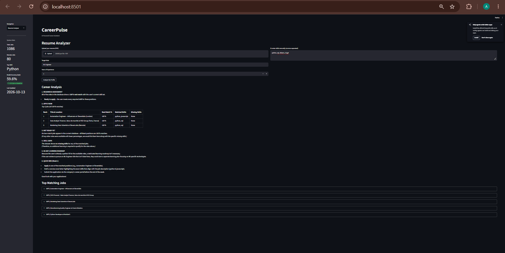
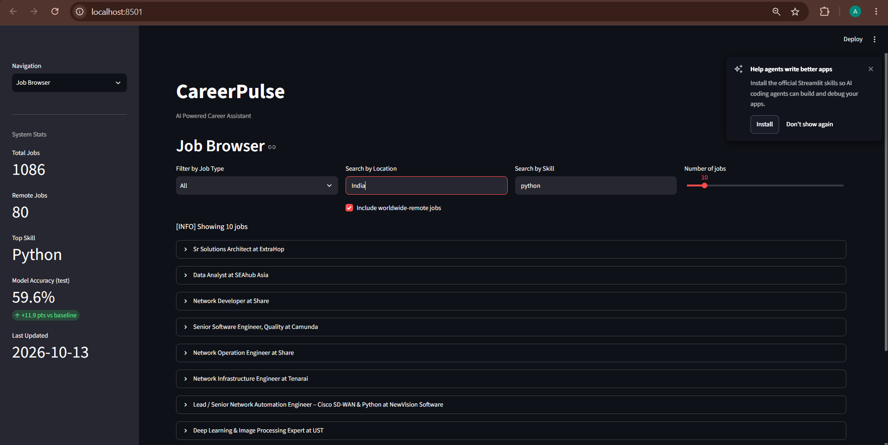
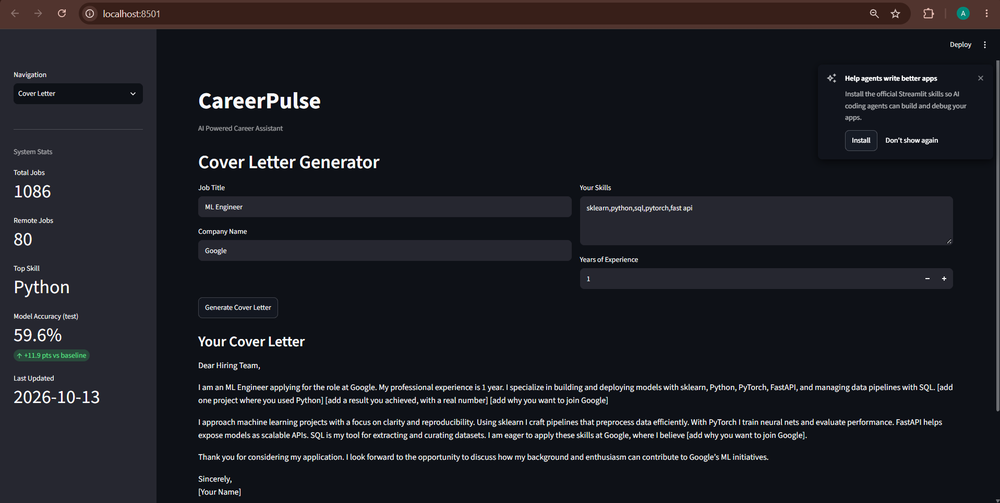
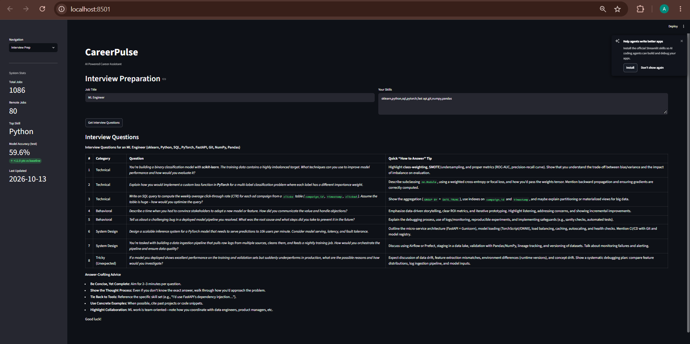

# CareerPulse - AI Career Assistant

[](https://github.com/amit-0333/careerpulse/actions/workflows/tests.yml)

CareerPulse fetches live tech job postings, extracts the skills each job asks for, and compares them with **your** skills. The match percentage is calculated by code, never guessed by an LLM. An LLM (Groq) then turns those real numbers into career advice, a cover letter and interview questions.



## What it does

- **Job data pipeline** - fetches jobs from public APIs, cleans them, removes duplicates, keeps tech roles
- **Skill extraction** - 213 skills, matched with context rules so "go" the verb is not "Go" the language, and `C++` / `C#` work
- **Match scoring** - normalizes synonyms (`JS` = javascript, `sklearn` = scikit-learn, `ML` = machine learning), separates required vs nice-to-have skills when the posting says so, and computes the match % in code
- **AI career coach** - the LLM gets the real scores and explains gaps; it does not calculate them
- **Cover letter** - uses only the skills and years you enter; missing details become `[placeholders]`
- **Resume parser** - upload a PDF and skills are extracted automatically
- **Interview prep** and a **90-day roadmap**
- **MLOps parts** - River online-learning classifier, MLflow run tracking, drift check, APScheduler jobs

## Screenshots

### Job Browser
Filter by type, location (country, city or remote) and skill.



### Cover Letter


### Interview Prep


## How it works

```
Job APIs -> ingestion (+dedup) -> preprocessing (clean, keep tech jobs, extract skills)
         -> SQLite -> features (TF-IDF, skill columns) -> River model + MLflow
Your skills / resume -> normalize -> match % (code) -> LLM explains the result
```

## Tech stack

| Area | Tools |
|---|---|
| Language | Python 3.13 |
| Data | SQLite, SQLAlchemy, pandas, scikit-learn (TF-IDF) |
| Skill matching | regex rules with context checks, synonym map |
| Model | River (MultinomialNB, online learning) |
| Tracking | MLflow (SQLite backend) |
| LLM | Groq API |
| Serving | FastAPI, Streamlit |
| Automation | APScheduler |
| Quality | pytest (67 tests), GitHub Actions |

## Data sources

RemoteOK, Arbeitnow and Adzuna work. The Muse integration exists in the code but currently returns HTTP 403, so it adds no jobs.

## Setup

**1. Clone and install**

Linux / macOS:
```bash
git clone https://github.com/amit-0333/careerpulse.git
cd careerpulse
python3 -m venv venv
source venv/bin/activate
pip install -r requirements.txt
```

Windows (PowerShell):
```powershell
git clone https://github.com/amit-0333/careerpulse.git
cd careerpulse
python -m venv venv
venv\Scripts\activate
pip install -r requirements.txt
```

**2. Add keys** in a `.env` file in the project root:
```
GROQ_API_KEY=your_key
ADZUNA_APP_ID=your_id
ADZUNA_APP_KEY=your_key
```
Without `GROQ_API_KEY` the AI features (analysis, cover letter, interview prep) will not work. Without Adzuna keys that source is skipped.

**3. Build the data** (same on every OS):
```bash
python -m pipeline.ingestion
python -m pipeline.preprocessing
python -m pipeline.features
python -m model.online_learner
```

**4. Run** (two terminals, venv active in both):
```bash
python -m serving.api
python -m streamlit run serving/dashboard.py
```
Open http://localhost:8501. API docs: http://localhost:8000/docs

**5. Tests**
```bash
python -m pytest -q
```

## API endpoints

| Method | Endpoint | Description |
|---|---|---|
| GET | `/health` | Health check |
| GET | `/stats` | Database stats |
| GET | `/jobs` | Browse jobs (`limit`, `source`, `location`, `include_remote`) |
| POST | `/analyze` | Match skills against jobs |
| POST | `/upload-resume` | Upload a PDF and analyze |
| POST | `/cover-letter` | Generate a cover letter |
| POST | `/interview-prep` | Get interview questions |

## Project structure

```
careerpulse/
├── pipeline/   ingestion, dedup, dedup_cleanup, preprocessing, features,
│               skills, skill_extractor, skill_matching, location
├── model/      online_learner, llm_coach, resume_parser
├── mlops/      tracking, drift, evaluation
├── serving/    api, dashboard
├── scheduler/  jobs
├── tests/      pytest suite
├── demo/       screenshots
└── .github/workflows/tests.yml
```

## Model evaluation (honest numbers)

The River model predicts a job's category (software engineering, data science, ...).

- With the job title hidden, it only slightly beats the baseline (52.2% vs 47.7%).
- Going from 789 to 1,086 jobs did not change held-out accuracy (59.7% to 59.6%), so I do not claim it improves with more data. Running accuracy during training rises until about 800 jobs and then flattens.
- Small classes are weak: `qa_testing` had 0% recall.
- With the job title hidden, it only slightly beats the baseline.
- Category labels come from title keywords, so a plain rule does this task better. The model is here to show online learning, MLflow tracking and retraining, **not** as a production classifier.

Reproduce: `python -m mlops.evaluation`

## Demo

<!-- Add a GIF:  -->
*Demo GIF coming soon.*

## Limitations and future work

- **Not deployed.** It runs locally. Docker files exist but have not been tested.
- **Scheduler** runs only while its process is running (full pipeline daily, ingestion every 6 hours).
- **Drift detection** is basic: it can flag "volume drift" just because new jobs were added. A statistical test (PSI / chi-square) is planned.
- **Skills** come from a fixed list of 213. Skills outside it are not detected.
- **Required vs nice-to-have** is only detected when the posting uses clear wording; otherwise every skill counts as required.
- **Location filter** uses a built-in list of countries and cities. Unknown places match only by exact text. Jobs with no location never match a place search.
- **Data:** about 4% of descriptions had broken characters from a source encoding issue. Non-tech jobs may be re-added by ingestion and removed again by preprocessing.
- **The Muse** source is disabled (HTTP 403).
- **90-day roadmap** is free text from the LLM, so formatting can be uneven.
- Planned: structured roadmap output, drift tests, Docker deployment with persistent storage.

## Author

**Amit Kumar** - [@amit-0333](https://github.com/amit-0333)

## License

MIT